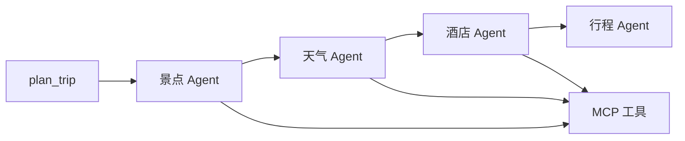

# 项目笔记

## 1. LangChain

LangChain 是组装 LLM 应用的 Python 框架：聊天模型、工具和 Agent 的接口形状统一，便于把不同厂商的模型和外部工具接到同一套调用上。`create_agent` 根据系统提示、模型与工具列表造出一个可 `ainvoke` 的 Agent；模型若决定调用工具，框架会执行工具并把结果送回模型，直到产出最终文本。

本项目用它编排四个 Agent，都在 `backend/app/agents/trip_planner_agent.py`：

- 景点、天气、酒店三个 Agent 带上高德 MCP 工具
- 行程规划 Agent 的工具列表为空，只根据前三步的文本写行程 JSON
- 四个 Agent 共用 `llm_service.get_llm()` 返回的同一个模型实例
- 调用形式是 `ainvoke({"messages": [HumanMessage(content=query)]})`，取最后一条消息的 `content`

提示词和行程 JSON Schema 在 `prompts.py`。本仓库没有自己写 `@tool`，工具全部来自 MCP adapter。

## 2. langchain-openai 与 MiniMax

`langchain-openai` 里的 `ChatOpenAI` 实现 LangChain 的聊天模型接口，按 OpenAI Chat Completions 的请求格式说话。只要对方提供兼容的 `base_url` 和 API Key，就可以把 MiniMax、以及其他兼容服务，接到同一套 `create_agent` 上。

MiniMax 是模型服务。本项目走它的 OpenAI 兼容地址，默认 `https://api.minimaxi.com/v1`，模型名默认 `MiniMax-M2.7`。

本项目在 `backend/app/services/llm_service.py` 里懒加载一个全局 `ChatOpenAI`：温度 `1.0`，不限制 `max_tokens`，单次超时 600 秒，客户端最多重试 3 次。密钥和地址来自 `MINIMAX_API_KEY`、`MINIMAX_BASE_URL`、`MINIMAX_MODEL`；这三个为空时回落到遗留的 `OPENAI_*` 字段。缺少模型密钥只在启动时警告，第一次真正规划才会在 `get_llm()` 抛错。

## 3. MCP 与 langchain-mcp-adapters

MCP（Model Context Protocol）是模型和外部工具之间的协议：工具运行在独立的 Server 进程里，Client 通过 stdio 或 HTTP 发现工具、传参数、拿结果。`langchain-mcp-adapters` 是把 MCP 工具转成 LangChain `BaseTool` 的适配库，这样 `create_agent` 不用关心传输细节。

本项目只用 stdio。`backend/app/services/amap_service.py` 用当前 Python 解释器执行 `python -m amap_mcp_server`，把 `AMAP_API_KEY` 写进子进程环境变量 `AMAP_MAPS_API_KEY`，再 `load_mcp_tools`。会话和工具列表在进程内只建一次。

三个带工具的 Agent 拿到的是同一批工具对象、同一条 stdio 连接，所以 `plan_trip` 必须串行：景点、天气、酒店依次 `await`。并发会抢这条连接。首次初始化用 `asyncio.Lock` 挡住同时进来的请求。应用关闭时没有调用 `AsyncExitStack.aclose()`，MCP 子进程跟随后端进程一起退出。

## 4. amap-mcp-server 与高德地图

高德开放平台提供两套与本仓库相关的能力，密钥不同：

| | Web 服务 API | Web 端 JS API |
| --- | --- | --- |
| 谁在调用 | 后端 MCP 子进程 | 浏览器里的结果页 |
| 本仓库的入口 | `amap-mcp-server` | `@amap/amap-jsapi-loader` |
| 密钥 | `AMAP_API_KEY` | `VITE_AMAP_WEB_JS_KEY` |

`amap-mcp-server`（锁定 `0.1.11`）把高德 Web 服务包成 MCP 工具。提示词实际点名的只有两个：`maps_text_search`（景点关键词、酒店关键词）和 `maps_weather`（城市天气）。该包还会注册步行、驾车、公交路线工具，当前 Agent 不调用。

景点查询用 `preferences` 的第一项，没有偏好时关键词是「景点」。酒店查询的关键词固定为「酒店」，不读取住宿偏好。

结果页地图在 `frontend/src/views/Result.vue`：加载 `AMap.Marker`、`AMap.Polyline`、`AMap.InfoWindow`，给景点打点，再用直线把相邻景点连起来。这条线不请求高德路径规划。

## 5. FastAPI 与 uvicorn

FastAPI 是 Python 的 Web 框架：用类型标注声明请求体和响应体，自动生成 OpenAPI 文档。uvicorn 是跑 ASGI 应用的服务器，负责监听端口并把 HTTP 请求交给 FastAPI。

本项目入口是 `backend/app/api/main.py`。启动时打印配置并调用 `validate_config()`，缺少 `AMAP_API_KEY` 会直接拒绝启动。CORS 允许 `CORS_ORIGINS` 里的前端源。

两个业务路由都挂在 `/api` 下：

- `POST /api/trip/plan`：把 `TripRequest` 交给 `MultiAgentTripPlanner.plan_trip`
- `GET /api/poi/photo`：按景点名向 Unsplash 要一张图片

交互式文档在 `/docs` 和 `/redoc`。本地可以用 `python -m uvicorn app.api.main:app --host 0.0.0.0 --port 8000`，或 `python run.py`（读 `HOST` / `PORT`）。Render 上必须使用平台注入的 `$PORT`。

## 6. Pydantic 与 pydantic-settings

Pydantic 用类声明数据形状，并在赋值时做校验和转换。`pydantic-settings` 在此之上从环境变量和 `.env` 填充配置，未提供的字段用类上的默认值。

本项目的 HTTP 模型在 `backend/app/models/schemas.py`：`TripRequest` 限制旅行天数 1 到 30；`TripPlan`、`DayPlan`、`Attraction`、`WeatherInfo` 描述返回的行程。`WeatherInfo` 会在校验前去掉温度字符串里的 `°C`。

`parsers.py` 从模型文本里抽出 JSON（Markdown 代码块或第一个 `{` 到最后一个 `}`），再用请求里的城市、日期、交通和住宿补缺字段，最后 `TripPlan(**data)` 校验。经纬度缺失或为 `0` 时，会填成北京附近的默认坐标。抽不出 JSON 或校验失败时，`fallback.py` 按天数生成占位行程；这条路径仍作为成功响应返回。

配置类是 `backend/app/config.py` 的 `Settings`。它读取进程环境变量和**当前工作目录**下的 `.env`，大小写不敏感，忽略多余字段。本地要在 `backend/` 下启动，才会读到 `backend/.env`。

## 7. Vue 3、Vue Router 与 Vite

Vue 3 是浏览器端的界面框架：用模板描述页面，用响应式数据驱动更新。Vue Router 把 URL 对应到页面组件。Vite 是开发服务器和构建工具：开发时按需编译，`pnpm build` 时先跑 `vue-tsc` 做类型检查，再把源码打成静态文件。

本项目只有两个路由，写在 `frontend/src/main.ts`：`/` 是 `Home.vue`，`/result` 是 `Result.vue`。首页用 `src/utils/tripForm.ts` 把 dayjs 日期收成 `YYYY-MM-DD`，天数是结束日减开始日再加 1。结果页在浏览器里改行程，并用 html2canvas、jsPDF 导出图片或 PDF；这些修改没有保存接口，刷新即丢失。

以 `VITE_` 开头的变量在构建时写进静态文件。改了 Render 上的 `VITE_API_BASE_URL` 或 `VITE_AMAP_WEB_JS_KEY` 之后，需要重新构建前端。

## 8. Ant Design Vue

Ant Design Vue 是 Vue 3 的组件库，提供表单、日期选择、卡片、菜单、按钮等现成界面，并处理校验提示和基础布局。

本项目在 `main.ts` 里 `app.use(Antd)` 全局注册，并引入 `ant-design-vue/dist/reset.css`。首页用 `a-form`、`a-input`、`a-date-picker` 收集旅行需求；结果页用 `a-card`、`a-menu`、`a-dropdown` 组织概览、预算、每日行程和导出操作。

## 9. axios

axios 是浏览器里的 HTTP 客户端，用来发请求、设置超时和统一处理错误。

本项目的客户端在 `frontend/src/services/api.ts`。`baseURL` 来自 `VITE_API_BASE_URL`，缺省是 `http://localhost:8000`。超时设为 1,200,000 毫秒，用来盖住四次串行的模型调用。页面只走两个方法：`POST /api/trip/plan` 和 `GET /api/poi/photo`。失败时经 `errorMessage.ts` 收成可读文案。

## 10. Unsplash

Unsplash 是图库的 HTTP API：用 Access Key 按关键词搜索照片，返回图片 URL。它与行程规划无关，只给结果页配图。

本项目在 `backend/app/services/unsplash_service.py` 用同步的 `requests` 调用 `https://api.unsplash.com/search/photos`。`GET /api/poi/photo` 先搜「景点名 China landmark」，没有结果再搜景点名。`UNSPLASH_ACCESS_KEY` 可留空；留空或请求失败时返回空的 `photo_url`，不阻断行程展示。

## 11. uv 与 pnpm

uv 是 Python 的包安装工具，本仓库用它把 `backend/requirements.txt` 装进环境。除 `amap-mcp-server==0.1.11` 外，其余依赖只写了最低版本，没有锁文件；不同时间安装，LangChain 的具体版本可能不同。

pnpm 是前端的包管理器。CI 用 pnpm 9，并以 `frontend/pnpm-lock.yaml` 做 `pnpm install --frozen-lockfile`。仓库里同时留着 `package-lock.json`，安装和 CI 不以它为准。

## 12. Render

Render 是应用托管平台。本仓库拆成两个服务：后端是 Web Service，前端是 Static Site。push 本身不会自动发布，构建设在 Render 的服务配置里。

后端根目录 `backend`，构建命令安装 uv 再 `uv pip install -r requirements.txt --system`，启动命令是 `python -m uvicorn app.api.main:app --host 0.0.0.0 --port $PORT`。模型密钥、高德 Key 和 `CORS_ORIGINS` 配在服务的环境变量里。免费实例大约 15 分钟无请求会休眠；一次规划要串行多次模型调用，冷启动后的首个请求会更慢。

前端根目录 `frontend`，构建 `pnpm install && pnpm build`，发布目录 `dist`。`VITE_*` 在构建时生效。当前站点是 [trip-planner-a9kw.onrender.com](https://trip-planner-a9kw.onrender.com)。

## 13. pytest、Vitest 与 GitHub Actions

pytest 和 Vitest 都是单元测试运行器，分别对应 Python 和前端。GitHub Actions 用仓库里的 YAML 在 push 或 Pull Request 时自动执行这些检查。

后端测试在 `backend/tests/`，覆盖 JSON 提取、行程补字段和备用计划，不调用 MiniMax，也不启动 MCP。前端测试在 `frontend/src/utils/*.test.ts`，覆盖天数计算和错误文案。`pnpm build` 额外执行 `vue-tsc`。

`.github/workflows/ci.yml` 在 `main` 的 push 和 pull request 上跑这两条流水线：后端是 Python 3.12，前端是 Node.js 22 与 pnpm 9。CI 不访问 MiniMax、高德或 Unsplash。
